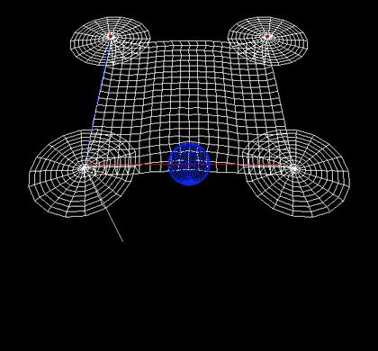

# Cloth Simulation

A 3D cloth simulation in C++ with real-time OpenGL rendering through Qt. Cloth is modelled as a grid of
point masses joined by springs. You can build pieces of different shapes, sew them together, pin them to hooks
and push them with time-varying forces.



*The default scene: a square cloth with a round piece sewn to each corner, hanging from two hooks. The sphere
marks where a sinusoidal force pushes the cloth during the first five seconds; its colour shows the force's
strength.*

Started as a school project, then extended.

## Features

**Physics**
- Each mass feels gravity, linear damping (−λv) and Hooke's-law forces from the springs attached to it.
- Two time integrators, switchable while the simulation runs:
  - **Euler-Cromer** (semi-implicit Euler): fast, first order.
  - **Runge-Kutta 4**: fourth order, much more stable for stiff springs.

**Cloth shapes**
- **Rectangle**: a regular grid of masses with springs to their neighbours.
- **Disc**: masses on concentric rings, joined radially and around each ring.
- **Chain**: masses in a line.
- **Composite**: joins any cloths by adding springs between masses closer than a distance ε, so pieces can be
  sewn together.

**Constraints**
- **Hook**: pins every mass within a radius in place.
- **Impulse**: applies a constant force to the masses inside a sphere during a time window.
- **Sinusoidal impulse**: the same, but the force oscillates at a given frequency.

The code relies on polymorphism throughout: integrators, cloths and constraints share abstract base classes, and
drawing is separated from the physics, so the same system can be drawn as text or in OpenGL.

## Building and running

Requires Qt 5 (with the OpenGL module), qmake and a C++11 compiler. On Ubuntu or Debian:

```bash
sudo apt install qtbase5-dev libqt5opengl5-dev build-essential
```

Build out of source:

```bash
mkdir build && cd build
qmake ../cloth-sim.pro
make -j
./Qt_GL/cloth_sim          # OpenGL viewer
./text/cloth_sim_text      # text output: one mass falling, printed step by step
```

The scene is set up in [`Qt_GL/main_qt_gl.cc`](Qt_GL/main_qt_gl.cc): change the parameters there (mass,
spring stiffness, cloth sizes, hook positions, forces) to build your own.

### Controls

| Key | Action |
|---|---|
| Mouse drag | Rotate the view |
| Arrow keys, Q / E | Rotate the view |
| W / S | Move forward / back |
| A / D, R / F | Move left / right, up / down |
| Home | Reset the camera |
| Space | Pause / resume |
| 1 / 2 | Switch to Euler-Cromer / Runge-Kutta 4 |

## Code layout

```
general/   the physics library: vectors, masses, springs, cloths, constraints, integrators, the system
Qt_GL/     the OpenGL viewer (Qt widget, shaders, camera)
text/      a text viewer that prints positions to the terminal
```

The code is written in French. A short glossary:

| French | English |
|---|---|
| `Masse` | mass |
| `Ressort` | spring |
| `Tissu` (`Rectangle`, `Disque`, `Chaine`, `Compose`) | cloth (rectangle, disc, chain, composite) |
| `Contrainte` (`Crochet`, `Impulsion`, `Sin`) | constraint (hook, impulse, sinusoidal) |
| `Integrateur` | integrator |
| `Systeme` | the whole simulated system |
| `Vecteur3D` | 3D vector |
| `dessine` / `evolue` | draw / step forward in time |

---

*Cleanup and presentation (this README, build fixes, the demo GIF) were done with the help of Claude (Anthropic)
in 2026. The simulation itself is my own work.*
